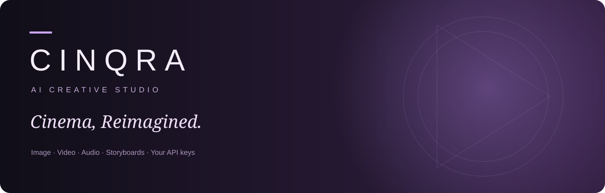

<div align="center">
  
  <h1>CINQRA</h1>
  <p><strong>AI CREATIVE STUDIO</strong></p>
  <p><em>Cinema, Reimagined.</em></p>
</div>



CINQRA brings image, video, audio and production planning into a local creative workspace. Connect your provider accounts, prepare references, review generation settings and costs, and organize results by project.

## Creative tools

- Image masks, editable image/text layers, local texture fill, manual extraction, expansion, relight adjustments and PNG/document export.
- Local video trim, crop/pad reframing, resize, audio control and FFmpeg MP4 export.
- Documented Higgsfield generation/edit/reference workflows, async jobs and output archiving.
- Google Gemini AI Director, editable storyboard suggestions and synthetic speech.
- Freepik OmniHuman talking-head workflow.
- Reusable characters, locations, props, product references and project storyboards.
- Shared canvas notes and workspace posts/remixes.
- History reuse, variation preparation, reviewed retries and image-to-video references.
- Separate saved-key, connection-check and generation-verification states.
- Per-settings estimates showing regular and discounted totals from your confirmed rates.
- CLI, stdio MCP, Photoshop UXP source and After Effects/Premiere import handoffs.

## Run from source

The source manifest declares Node 22.23.4–22.x. Checks on the build Mac also use Node 24.5.0. The packaged Mac application includes its runtime.

```sh
npm ci
cp .env.example .env.local
npm run dev -- --port 3017
```

Open `http://127.0.0.1:3017/en`. Set `APP_ORIGIN=http://127.0.0.1:3017` in local settings. Use **Connect API** to save provider credentials server-side.

| Provider | Credentials | Connected tools |
| --- | --- | --- |
| Higgsfield | Key ID and Secret | Supported image/video/reference, Cinema, Marketing and Genjutsu workflows |
| Google AI Studio | API key | AI Director and audio |
| Freepik | API key | OmniHuman and inherited compatible models |

Real paid generation testing requires your own keys, account access and balance. No paid outputs were used to verify this release. Connection checks verify the available authenticated endpoint, while completed jobs record generation verification.

## Cost preview

Choose a workflow and review **Cost before generation**. Save the current normal and discounted unit rates with an official pricing source. Rates match the selected pricing settings, including resolution and generated audio. Changed settings require a matching rate.

Estimates use your confirmed rates. Provider billing determines final charges. Token-based or unsupported pricing can remain unavailable. Automatic universal price discovery is pending.

## Mac package

Build on macOS with Xcode Command Line Tools installed.

```sh
npm run package:mac
```

Outputs are `dist/CINQRA.app` and an architecture-specific DMG. The package includes the standalone server, Node, static assets and FFmpeg. New packaged-app data and settings live in `~/Library/Application Support/CINQRA`.

The package targets the build machine's architecture and uses ad-hoc signing. Apple notarization requires your Apple Developer identity. Build-machine keys and workspace data are excluded. Back up existing source-mode data before moving to the packaged app.

## Projects and history

Select an active project before submitting a creative workflow. Its job, prompt, references and archived outputs link into the storyboard. Save historical Image/Video Studio jobs through **History actions**. Review restored attachments and settings before generating a retry or variation.

Project JSON exports contain references and protected media links. Download media before an offline editor handoff.

## Integrations

```sh
node integrations/cinqra.mjs help
node integrations/cinqra.mjs assets
node integrations/mcp-server.mjs
```

See [integration instructions](integrations/README.md) for CLI/MCP and Adobe setup. Adobe host execution remains unverified.

## Checks

```sh
npm run typecheck
npm run lint
npm test
npm run build
```

Tests cover provider contracts with mocks, task recovery, credential handling, workspace revisions, image operations and actual local FFmpeg rendering. PostgreSQL integration requires a configured test database. Paid provider output and Adobe hosts need separate acceptance checks.

## Current limits

Generative masked inpaint, automatic layer decomposition and dedicated AI background removal remain disabled where no verified adapter exists. Local color-key removal and texture fill are labelled. Video freeze extension holds the last frame. Audio re-voice/translation uses a synthetic voice without preserving original timing. Storyboards plan individual shots without assembling a final film.

Collaboration/community share one trusted server. Cloud identity and fine-grained project roles require further work. Feature delivery and provider contracts are detailed in [FEATURE-CHECKLIST.md](FEATURE-CHECKLIST.md) and [WORKFLOWS-NOTES.md](WORKFLOWS-NOTES.md).

## Data

Back up local task/media storage, `.cinqra-creative`, `.cinqra-creative-jobs` and `.cinqra-reliability`. Packaged-app data lives in Application Support. Keep `.env.local`, runtime data and private logs out of GitHub.

## License and provenance

CINQRA builds on [TechBeme/open-higgsfield](https://github.com/TechBeme/open-higgsfield) under the retained [MIT license](LICENSE). Its original README is preserved in [docs/UPSTREAM-README.md](docs/UPSTREAM-README.md). CINQRA is an independent project. Provider names identify their respective services.

Node and FFmpeg retain their own licenses. Mac packages include notices in `Contents/Resources/Licenses`.
